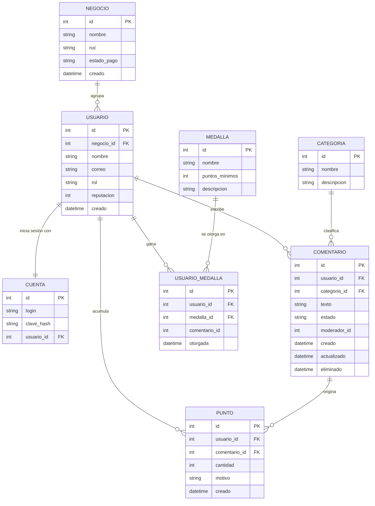
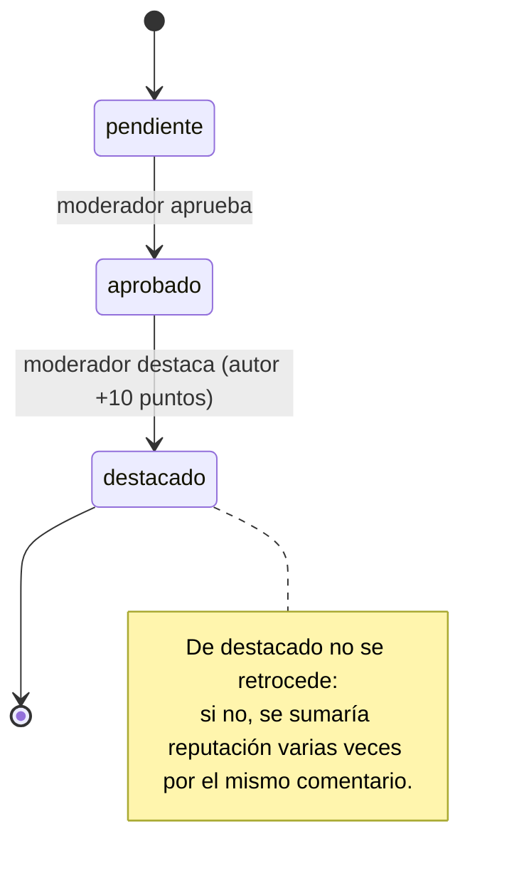

# Hito 1 · Ficha del negocio

**Pareja:** Robinson Benitez · Alexander Lazaro
**Paralelo:** Aplicaciones Web II A
**Negocio en una línea:** AyudaComún es una plataforma de soporte comunitario donde los clientes de un negocio ecuatoriano (tienda en línea o software) se ayudan entre sí, ganan puntos, reputación y medallas digitales, y el negocio paga una suscripción mensual por su comunidad.

## 1. Negocio de referencia

**StartupTalky** (fundador Shubham Kumar, Bangalore, India; activo desde junio 2018) es una comunidad y medio para emprendedores. Empezó con grupos de Facebook, uno de ellos con 100 mil miembros, y creció hasta un sitio web con más de un millón de visitas al mes. A los miembros no les vende nada: tienen contenido y conversación gratis, y el dinero llega de terceros. Sus ingresos vienen de afiliados, Google AdSense, alianzas con marcas y servicios de link-building para otras marcas y agencias. El fundador declara unos 10.000 dólares de ingresos al mes, 99 dólares de costo inicial, un fundador y 13 empleados. Como en todos los casos de Starter Story, estas cifras las declara el propio fundador y nadie las audita. Tomamos de este caso que el valor está en una comunidad activa. Lo que cambiamos es quién paga: en lugar de publicidad y afiliados, AyudaComún cobra una suscripción mensual al negocio dueño de la comunidad, y sus clientes participan sin pagar.

**Enlace:** https://www.starterstory.com/stories/startuptalky

## 2. Caso de contraste

**Yahoo Answers** (cerró el 4 de mayo de 2021) era una comunidad gratuita de preguntas y respuestas donde los usuarios ganaban puntos y niveles por participar. Es comparable a nuestra idea: ayuda entre usuarios más un sistema de puntos. Nuestra hipótesis es que fracasó por una diferencia de fondo en los incentivos y en quién paga la moderación. Los puntos premiaban la cantidad de respuestas, así que había quien respondía sin saber solo para sumar. Además el servicio era gratuito y no tenía un ingreso propio que financiara moderar a esa escala: la calidad cayó, los usuarios expertos se fueron a foros especializados y la comunidad se degradó. En AyudaComún un comentario nace pendiente y solo gana reputación cuando un moderador lo destaca, nunca por publicar, y la suscripción del negocio financia a su propio moderador.

**Fuente:** https://technical.ly/software-development/yahoo-answers-shutdown/ · https://www.lenovys.com/en/blog/yahooanswers-shuts-down/

## 3. Adaptación al Ecuador

1. **Pago por transferencia o depósito.** Los negocios pequeños ecuatorianos suelen pagar enviando la foto del comprobante, no con tarjeta recurrente. Por eso la suscripción no se activa sola: el negocio queda en `pago_por_verificar` hasta que el equipo de la plataforma confirma el pago, y mientras no esté `activa` no puede publicar comentarios nuevos.
2. **Datos móviles limitados y conexión irregular fuera de las ciudades grandes** (por ejemplo, en cantones de Manabí). Muchos clientes entran desde el celular con plan prepago. Por eso el listado va paginado (máximo 20 comentarios por página, el servidor rechaza más), sin imágenes ni adjuntos.
3. **Facturación electrónica del SRI.** El negocio que contrata necesita RUC (muchos están en RIMPE) y espera una factura por cada mensualidad. Por eso `Negocio` guarda el RUC como dato obligatorio de 13 caracteres.

**Qué cambió en el modelo por estas restricciones:** por la restricción 1 agregamos a `Negocio` el atributo `estado_pago` (uno de: pago_por_verificar, activa, vencida), y el servidor solo acepta comentarios nuevos de una comunidad cuando el estado de pago de su negocio es `activa`; si no, responde 403.

## 4. Modelo de datos

> **Corrección del modelo (Hito 2):** el docente pidió ampliar el modelo. Pasamos de 3 a **8 tablas**: agregamos `Categoria`, `Punto` (libro de puntos), `Medalla` (catálogo), `UsuarioMedalla` (medallas ganadas) y `Cuenta` (solo para iniciar sesión), y **corregimos `Comentario`**: ya no guarda la medalla como texto; ahora tiene categoría, quién lo moderó, fecha de actualización y borrado lógico.

### Entidad: Negocio

| Atributo | Tipo | Obligatorio | Ejemplo |
|----------|------|-------------|---------|
| id | número entero | sí | 1 |
| nombre | texto | sí | Tienda Manta Tech |
| ruc | texto de 13 caracteres, único | sí | 1391234567001 |
| estado_pago | uno de: pago_por_verificar, activa, vencida | sí | activa |
| creado | fecha y hora | sí | 01-10-2026 09:15 |

### Entidad: Usuario

| Atributo | Tipo | Obligatorio | Ejemplo |
|----------|------|-------------|---------|
| id | número entero | sí | 2 |
| negocio | referencia a Negocio | sí | 1 |
| nombre | texto | sí | Luis Anchundia |
| correo | texto, único | sí | luis@mantatech.ec |
| rol | uno de: miembro, moderador | sí | moderador |
| reputacion | número entero (suma de sus puntos) | sí | 10 |
| creado | fecha y hora | sí | 01-10-2026 09:20 |

### Entidad: Cuenta (nueva, solo para iniciar sesión)

| Atributo | Tipo | Obligatorio | Ejemplo |
|----------|------|-------------|---------|
| id | número entero | sí | 1 |
| login | texto, único | sí | luis |
| clave_hash | texto (la clave nunca se guarda en claro) | sí | pbkdf2$120000$... |
| usuario | referencia a Usuario (uno a uno) | sí | 2 |

### Entidad: Categoria (nueva)

| Atributo | Tipo | Obligatorio | Ejemplo |
|----------|------|-------------|---------|
| id | número entero | sí | 1 |
| nombre | texto, único | sí | Dudas técnicas |
| descripcion | texto | no | Problemas con equipos y programas |

### Entidad: Comentario (corregida)

| Atributo | Tipo | Obligatorio | Ejemplo |
|----------|------|-------------|---------|
| id | número entero | sí | 310 |
| usuario | referencia a Usuario (autor) | sí | 1 |
| categoria | referencia a Categoria | no | 1 |
| texto | texto de hasta 1000 caracteres | sí | Borra la caché de la app y vuelve a entrar. |
| estado | uno de: pendiente, aprobado, destacado | sí | pendiente |
| moderador | referencia a Usuario que lo moderó | no (vacío hasta moderarlo) | 2 |
| creado | fecha y hora | sí | 05-10-2026 11:00 |
| actualizado | fecha y hora | sí | 05-10-2026 11:30 |
| eliminado | fecha y hora (borrado lógico) | no | |

### Entidad: Punto (nueva, libro de puntos)

| Atributo | Tipo | Obligatorio | Ejemplo |
|----------|------|-------------|---------|
| id | número entero | sí | 1 |
| usuario | referencia a Usuario que gana los puntos | sí | 1 |
| comentario | referencia a Comentario que los originó | no | 310 |
| cantidad | número entero | sí | 10 |
| motivo | texto | sí | comentario destacado |
| creado | fecha y hora | sí | 05-10-2026 11:30 |

### Entidad: Medalla (nueva, catálogo)

| Atributo | Tipo | Obligatorio | Ejemplo |
|----------|------|-------------|---------|
| id | número entero | sí | 2 |
| nombre | texto, único | sí | Ayudante |
| puntos_minimos | número entero | sí | 25 |
| descripcion | texto | no | Ayuda con frecuencia |

### Entidad: UsuarioMedalla (nueva, medallas ganadas)

| Atributo | Tipo | Obligatorio | Ejemplo |
|----------|------|-------------|---------|
| id | número entero | sí | 1 |
| usuario | referencia a Usuario | sí | 1 |
| medalla | referencia a Medalla | sí | 1 |
| comentario | referencia al Comentario que la hizo ganar | no | 310 |
| otorgada | fecha y hora | sí | 05-10-2026 11:30 |

Un usuario no puede tener la misma medalla dos veces (índice único usuario + medalla).

### Relaciones

| Entidades | Cardinalidad | Frase |
|-----------|--------------|-------|
| Negocio — Usuario | 1—N | Un negocio agrupa a muchos usuarios; cada usuario pertenece a un solo negocio. |
| Usuario — Cuenta | 1—1 | Un usuario tiene una cuenta para iniciar sesión; cada cuenta es de un solo usuario. |
| Usuario — Comentario | 1—N | Un usuario escribe muchos comentarios; cada comentario tiene un solo autor. |
| Categoria — Comentario | 1—N | Una categoría agrupa muchos comentarios; un comentario tiene una categoría como máximo. |
| Usuario — Punto | 1—N | Un usuario acumula muchos movimientos de puntos; cada movimiento es de un solo usuario. |
| Comentario — Punto | 1—N | Un comentario puede originar movimientos de puntos (hoy uno, al destacarse). |
| Usuario — Medalla | N—M | Un usuario gana muchas medallas y una medalla la ganan muchos usuarios; la tabla `UsuarioMedalla` los une. |

### Structs en Go

Están todos en `internal/modelos/modelos.go` (los 8 se crean al arrancar con `AutoMigrate`):

```go
type Negocio struct {
	ID         uint      `gorm:"primaryKey" json:"id"`
	Nombre     string    `gorm:"not null" json:"nombre"`
	RUC        string    `gorm:"not null;size:13;uniqueIndex" json:"ruc"`
	EstadoPago string    `gorm:"not null;default:pago_por_verificar" json:"estado_pago"`
	Creado     time.Time `json:"creado"`
	Usuarios   []Usuario `json:"usuarios,omitempty"`
}

type Usuario struct {
	ID          uint             `gorm:"primaryKey" json:"id"`
	NegocioID   uint             `gorm:"not null;index" json:"negocio_id"`
	Nombre      string           `gorm:"not null" json:"nombre"`
	Correo      string           `gorm:"not null;uniqueIndex" json:"correo"`
	Rol         string           `gorm:"not null;default:miembro" json:"rol"`
	Reputacion  int              `gorm:"not null;default:0" json:"reputacion"`
	Creado      time.Time        `json:"creado"`
	Comentarios []Comentario     `json:"comentarios,omitempty"`
	Puntos      []Punto          `json:"puntos,omitempty"`
	Medallas    []UsuarioMedalla `json:"medallas,omitempty"`
}

type Cuenta struct {
	ID        uint    `gorm:"primaryKey" json:"id"`
	Login     string  `gorm:"not null;uniqueIndex" json:"login"`
	ClaveHash string  `gorm:"not null" json:"-"`
	UsuarioID uint    `gorm:"not null;uniqueIndex" json:"usuario_id"`
	Persona   Usuario `gorm:"foreignKey:UsuarioID;references:ID" json:"-"`
}

type Categoria struct {
	ID          uint         `gorm:"primaryKey" json:"id"`
	Nombre      string       `gorm:"not null;uniqueIndex" json:"nombre"`
	Descripcion string       `json:"descripcion"`
	Comentarios []Comentario `json:"comentarios,omitempty"`
}

type Comentario struct {
	ID          uint           `gorm:"primaryKey" json:"id"`
	UsuarioID   uint           `gorm:"not null;index" json:"usuario_id"`
	CategoriaID *uint          `gorm:"index" json:"categoria_id"`
	Texto       string         `gorm:"not null;size:1000" json:"texto"`
	Estado      string         `gorm:"not null;default:pendiente;index" json:"estado"`
	ModeradorID *uint          `json:"moderador_id"`
	Creado      time.Time      `json:"creado"`
	Actualizado time.Time      `json:"actualizado"`
	Eliminado   gorm.DeletedAt `gorm:"index" json:"-"`
}

type Punto struct {
	ID           uint      `gorm:"primaryKey" json:"id"`
	UsuarioID    uint      `gorm:"not null;index" json:"usuario_id"`
	ComentarioID *uint     `gorm:"index" json:"comentario_id"`
	Cantidad     int       `gorm:"not null" json:"cantidad"`
	Motivo       string    `gorm:"not null" json:"motivo"`
	Creado       time.Time `json:"creado"`
}

type Medalla struct {
	ID            uint   `gorm:"primaryKey" json:"id"`
	Nombre        string `gorm:"not null;uniqueIndex" json:"nombre"`
	PuntosMinimos int    `gorm:"not null" json:"puntos_minimos"`
	Descripcion   string `json:"descripcion"`
}

type UsuarioMedalla struct {
	ID           uint      `gorm:"primaryKey" json:"id"`
	UsuarioID    uint      `gorm:"not null;uniqueIndex:idx_usuario_medalla" json:"usuario_id"`
	MedallaID    uint      `gorm:"not null;uniqueIndex:idx_usuario_medalla" json:"medalla_id"`
	ComentarioID *uint     `json:"comentario_id"`
	Otorgada     time.Time `json:"otorgada"`
	Medalla      Medalla   `gorm:"foreignKey:MedallaID" json:"medalla"`
}
```

Los valores cerrados (`estado`, `rol`, `estado_pago`) son constantes en Go; el `estado` se valida con `EstadoValido` y las transiciones con `TransicionPermitida` (`internal/comentarios/servicio/reglas.go`).

**Decisión de tipos que tuvimos que pensar:** `Creado` es `time.Time` y no texto, para ordenar y saber cuándo se publicó cada comentario. `CategoriaID` y `ModeradorID` son `*uint` (punteros) porque pueden estar vacíos. `Reputacion` es `int` y no `uint` porque podría bajar si se sanciona a un usuario. `ClaveHash` lleva `json:"-"` para que la clave jamás salga en una respuesta.

### Diagrama del modelo completo



**Decisiones discutibles del modelo y por qué las tomamos:**

- **`Punto` es un libro de movimientos y no solo un número en `Usuario`.** Así cada punto se puede explicar (de qué comentario vino y cuándo). `Usuario.reputacion` queda como total guardado para consultarlo rápido, y se actualiza en la misma transacción que crea el `Punto`.
- **`Medalla` pasó de texto en `Comentario` a un catálogo.** La medalla depende de la reputación del usuario, no de un comentario; por eso se corrigió. Cambiar los puntos necesarios para cada medalla ahora es cambiar una fila, no el código.
- **`Cuenta` está aparte de `Usuario`.** El inicio de sesión (clave, hash) no se mezcla con los datos de la comunidad, y la clave nunca viaja en las respuestas del perfil.
- **`Negocio` es una entidad aparte** porque un negocio tiene muchos usuarios y es quien paga y tiene estado de pago.

## 5. Máquina de estados

**Entidad con estados:** Comentario

| Estado | Qué significa |
|--------|---------------|
| pendiente (inicial) | El comentario se publicó y espera revisión de un moderador. No suma reputación. |
| aprobado | Un moderador revisó que el comentario es correcto y respeta las normas. |
| destacado | Un moderador lo marcó como una ayuda valiosa: el autor gana 10 puntos de reputación y puede recibir una medalla. |

| De | A | Quién la hace | Condición |
|----|---|---------------|-----------|
| pendiente | aprobado | moderador | El comentario existe y está en estado pendiente. |
| aprobado | destacado | moderador | El comentario está en estado aprobado; el servidor suma 10 puntos al autor y le asigna su medalla. |

**Transición prohibida y por qué:** de `destacado` no se vuelve a `aprobado` ni a `pendiente`. Si se pudiera retroceder, un moderador podría volver a destacar el mismo comentario y sumar reputación varias veces por la misma ayuda, y la reputación (y las medallas) dejarían de significar algo. Tampoco se permite saltar de `pendiente` a `destacado`: todo comentario pasa primero por revisión. El servidor responde 422 cuando se intenta una transición no permitida.

### Diagrama de estados



## 6. Roles y permisos

| Acción | Miembro | Moderador |
|--------|---------|-----------|
| Iniciar sesión | todos | todos |
| Ver comentarios y perfiles con reputación (con sesión iniciada) | todos | todos |
| Publicar un comentario | sí | sí |
| Pasar un comentario de pendiente a aprobado | no | todos |
| Pasar un comentario de aprobado a destacado | no | todos |
| Borrar un comentario | no | todos |

## 7. Mapa de endpoints por rol

Desde el Hito 2 todas las rutas (menos `/login`) piden el token en `Authorization: Bearer ...`; sin token responde 401. Los endpoints marcados **(plan)** están en el contrato (`docs/openapi.yaml`) pero se construyen después del Hito 2.

| Endpoint | Rol que lo llama | Pantalla que lo consume | Qué devuelve | Qué valida | Código si falla |
|----------|------------------|-------------------------|--------------|------------|-----------------|
| POST /login | sin sesión | Inicio de sesión | 200 con el token (vale 1 hora) | JSON válido; usuario y clave presentes y correctos | 400 (JSON), 422 (campos vacíos), 401 (usuario o clave incorrectos) |
| GET /comentarios | miembro, moderador | Feed de ayuda | 200 con la lista paginada (más nuevos primero) | token; `estado` dentro de la lista cerrada; `page` y `limit` numéricos, `limit` máximo 20 | 401, 400 |
| POST /comentarios | miembro, moderador | Nuevo comentario | 201 con el comentario creado en estado pendiente (el autor es quien tiene el token) | token; JSON válido; texto no vacío (máx. 1000); la categoría existe; el negocio tiene el pago `activa` | 401, 400 (JSON), 422 (texto o categoría), 403 (negocio sin pago activo) |
| GET /comentarios/{id} | miembro, moderador | Detalle del comentario | 200 con el comentario | token; el comentario existe | 401, 404 |
| PATCH /comentarios/{id}/estado | moderador | Bandeja de moderación | 200 con el comentario actualizado; si pasa a destacado: suma puntos, registra el punto y otorga la medalla | token; rol moderador; JSON válido; estado de la lista cerrada; transición permitida | 401, 403 (no es moderador), 400 (JSON), 404, 422 (estado o transición prohibida) |
| DELETE /comentarios/{id} | moderador | Bandeja de moderación | 204 sin cuerpo | token; rol moderador; el comentario existe | 401, 403, 404 |
| GET /usuarios | miembro, moderador | Perfil y ranking | 200 con los usuarios, su reputación, comentarios y medallas (con `Preload`, sin N+1) | token | 401 |
| GET /categorias (plan) | miembro, moderador | Nuevo comentario | 200 con las categorías | token | 401 |
| GET /usuarios/{id}/puntos (plan) | miembro, moderador | Perfil y ranking | 200 con el historial de puntos del usuario | token; el usuario existe | 401, 404 |
| GET /medallas (plan) | miembro, moderador | Perfil y ranking | 200 con el catálogo de medallas | token | 401 |
| GET /usuarios/{id}/medallas (plan) | miembro, moderador | Perfil y ranking | 200 con las medallas ganadas por el usuario | token; el usuario existe | 401, 404 |

### Matriz pantalla × endpoint

| Pantalla | POST /login | GET /comentarios | POST /comentarios | GET /comentarios/{id} | PATCH /comentarios/{id}/estado | DELETE /comentarios/{id} | GET /usuarios | GET /categorias | GET /usuarios/{id}/puntos | GET /medallas | GET /usuarios/{id}/medallas |
|----------|:-:|:-:|:-:|:-:|:-:|:-:|:-:|:-:|:-:|:-:|:-:|
| Inicio de sesión (todos) | ✓ | | | | | | | | | | |
| Feed de ayuda (todos) | | ✓ | | | | | | | | | |
| Nuevo comentario (todos) | | | ✓ | | | | | ✓ | | | |
| Detalle del comentario (todos) | | | | ✓ | | | | | | | |
| Bandeja de moderación (moderador) | | ✓ | | | ✓ | ✓ | | | | | |
| Perfil y ranking (todos) | | | | | | | ✓ | | ✓ | ✓ | ✓ |

**Dónde está cada cosa en el código:** la ruta y su protección en `internal/api/router.go`; el token y los roles en `internal/auth/`; la petición HTTP en `internal/comentarios/handler/`; las reglas del negocio en `internal/comentarios/servicio/`; la base de datos en `internal/comentarios/repositorio/`. Los ocho structs en `internal/modelos/modelos.go`.

## 8. Declaración de IA

Claude (Anthropic) para redactar el borrador de las secciones 1 a 7, los diagramas y el código de las reglas de estados, roles y pago; la pareja revisó, probó y ajustó el contenido.
